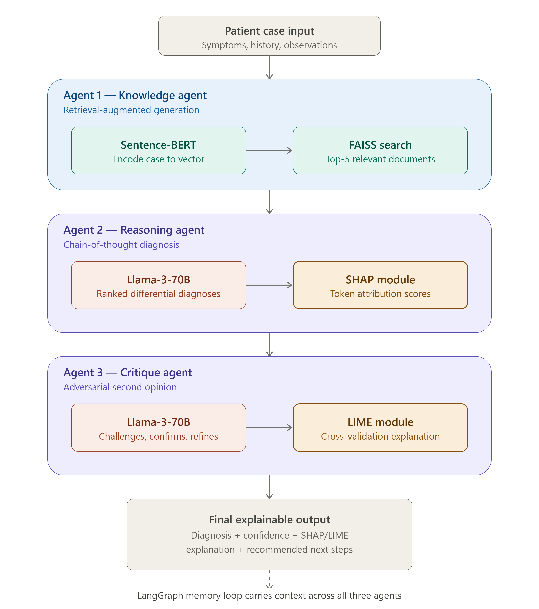
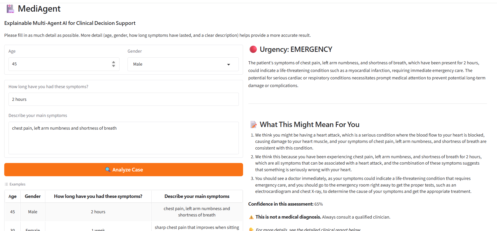
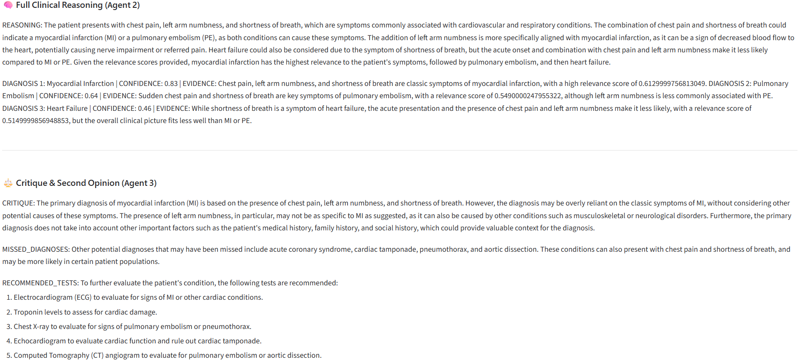
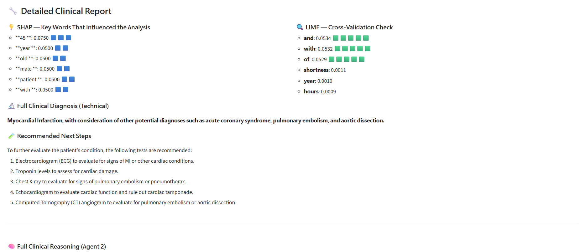
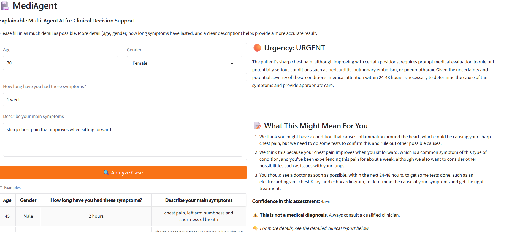
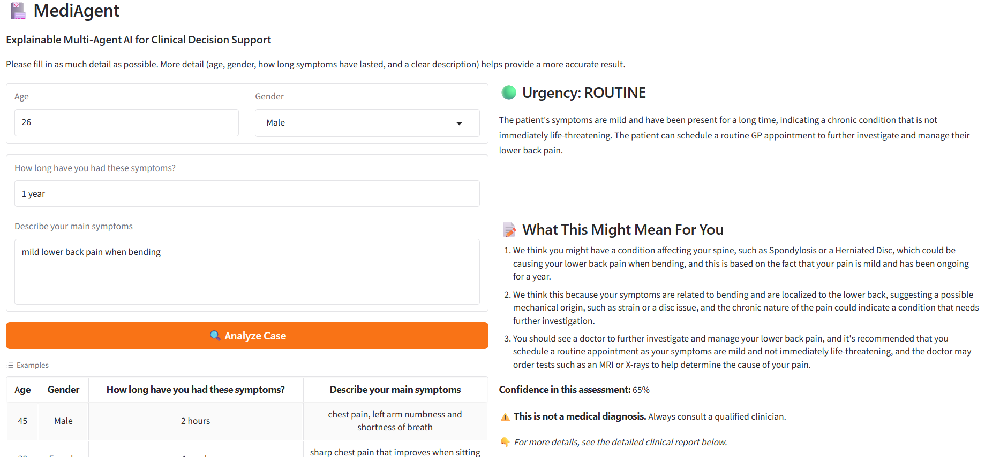

# MediAgent: Explainable Multi-Agent LLM System for Medical Question Answering

MSc AI dissertation project (National College of Ireland). Research prototype, not for real medical use.

## What it does
- **Knowledge Agent:** FAISS + Sentence-BERT (all-MiniLM-L6-v2) retrieves the top 3 passages from a small hand-written cardiopulmonary knowledge base (15 sentences).
- **Reasoning Agent:** Llama-3 via Groq gives step-by-step reasoning and ranked differentials.
- **Critique Agent:** adversarial second opinion on the first answer.
- LangGraph orchestration, urgency triage, plain-language patient summary, Gradio UI.
- SHAP and LIME are used as proxy token-relevance scores, not true model attribution.
- The system never recommends medications or dosages.

## Demo

*Note: the notebook retrieves the top 3 passages (k=3).*

## Results (from the saved notebook outputs)
- 10-case symptom test: no RAG 9/10, RAG + single agent 10/10, proposed 10/10.
- MedQA-USMLE, first 100 test questions (llama-3.3-70b): no RAG 78/100, RAG-augmented 25/100.
- Ablation, same 100 questions (llama-3.1-8b-instant): A LLM only 71, B +RAG 68, C +critique 71, D full system 73. No statistically significant differences (McNemar p=0.45 for A vs B, p=1.00 for A vs C).
- LLM runs vary, so the dissertation reports slightly different figures.

## Limitations
- Tiny hand-written knowledge base (15 chest-pain sentences), so retrieval is off-topic for most MedQA questions.
- The RAG-augmented MedQA run capped output at 5 tokens, so the 25% may also reflect answer-format parsing, not only retrieval mismatch.
- SHAP/LIME are proxy token-overlap scores, not true model attribution.
- Small 10-case test set, one pilot user.
- The statistics cell needs `conditions_ABC_results.json`, so run the ablation cell first.

## Run it
1. Open `mediagent.ipynb` in Google Colab.
2. Create a free Groq API key and replace `PASTE_YOUR_GROQ_API_KEY_HERE` in the cells that use it.
3. Run the cells in order. MedQA loads from Hugging Face (GBaker/MedQA-USMLE-4-options).
